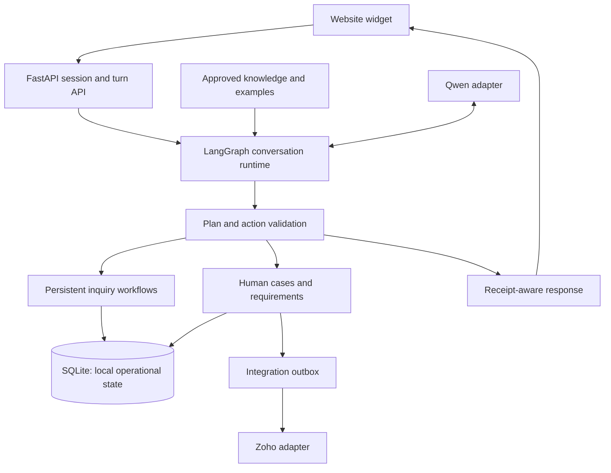
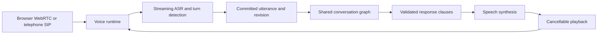

# Local architecture and implementation roadmap

Baseline: `lease-on-dynamic-behavior` at `4ec749d`. This branch builds a shared
inquiry foundation. It does not implement a live voice runtime or certify the
application for public production use.

## Runtime boundaries



The existing graph remains `propose → reduce_facts → knowledge → plan → execute
→ reply`. It receives committed text. Example and approved-register context is
also retrieved before model generation. Changes to external systems belong in
execution, not in the model's response draft.

`session.opportunity_id` is the current inquiry reference. A session can have a
purpose case and independent contact workflows. The present implementation does
not yet link multiple authenticated sessions to one inquiry; that is a later
migration, not a capability inferred from the diagram.

## Implemented foundation

* `app/workflows.py` owns callback collection and public progress projections.
* `inquiry_workflows` records one workflow per `(session_id, kind)` with its own
  status, version and internal data. Workflow updates and audit events commit in
  one transaction. Stale workflow writers receive an HTTP 409.
* Callback answers resume collection from persisted state, including after a
  new graph is constructed. Questions can interrupt collection. Contact
  corrections update the existing workflow and case.
* Completion requires an international phone-format candidate, local time,
  timezone and a non-past ISO date. Phone format is **not** number validity,
  ownership verification or permission to dial. Ambiguous dates and unsupported
  timezone input require clarification.
* Callback status is `collecting`, `requested` or `cancelled`; it is independent
  of chat channel and the purpose case's review status. Requested time is not a
  confirmed appointment. No dialing worker exists in this build.
* Human takeover prevents automatic callback collection from advancing; an
  explicit cancellation can still be recorded. Cancellation remains visible in
  case context and CRM updates, without cancelling insurance/onboarding review.
* Repeating a completed callback reconciles the case/outbox after a partial
  failure. Outbox keys include the callback workflow version. This is not a
  distributed exactly-once guarantee.
* Browser voice records an unavailable request. It does not change chat channel
  or set identity verified. A future trusted media-ready event must own activation.
* Insurance assistance routes to quote intake. Quote-only documents and an
  explicit unresolved insurance need block onboarding approval and production
  acceptance. A promoted task requires its full applicable checklist.
* Generic fit updates preserve an existing review's purpose and next action.
  Local CRM mirrors are not verified remote writes, and a Deal ID does not
  establish staff assignment.
* Turn retry lookup/storage is session-scoped. Legacy cached responses are read
  only when their stored session matches. Concurrent turn execution still needs
  an inquiry-level concurrency design.
* Example retrieval is controlled by `AGOC_SKIP_EXAMPLES`, not the model name.
* Public static assets are allowlisted; runtime files and source code cannot be
  fetched through the root static mount. Widget messages render as text.

The migration is additive: `db.init()` creates the workflow table without
rewriting existing sessions, cases or documents. Existing callbacks are not
automatically migrated or dialed. The next explicit callback request can reuse
existing contact facts and asks for missing required details.

## State ownership

| Concern | Current owner | Rule |
|---|---|---|
| Vehicle/customer facts | Session fact reducer | Preserve source and correction history |
| Callback collection | Workflow service | Never rewrite equipment from contact data |
| Active channel | Session/media boundary | A voice request is not a connection |
| Review purpose | Human case | Callback does not replace insurance/lease work |
| Document decisions | Requirement service and staff API | Receipt is not approval |
| Production readiness | Readiness gate | Quote intake cannot clear dispatch |
| CRM delivery | Outbox and Zoho adapter | Local mirror is not remote confirmation |
| Staff ownership | Explicit takeover | CRM synchronization is not acceptance |

`GET /v1/session/{id}`, turn responses and case detail expose a `workflows`
projection. Callback progress contains the last four phone digits, schedule
preference, validation label and next missing field, not the internal full number.
Existing transcript/API authorization limitations still apply.

## Voice target: next implementation boundary

The owner-selected speaking voice is recorded in `config/voice.json`, with the
original WhatsApp recording and prepared PCM reference in `assets/voices/owner/`.
This is a selection manifest for future integration, not an active TTS setting.
The future cloning-capable adapter should use profile `owner`; no cloned model
or generated speech has been produced. See the asset README for provenance and
limitations. Speaker references remain outside the public static-file allowlist.



Candidate runtime: LiveKit Agents. Start with browser voice. Validate the telephone
provider separately; existing Google Voice integration remains unverified.
Retain Ollama behind a provider-neutral model adapter. Compare streaming API
speech recognition with an evaluated open candidate; compare API TTS with Kokoro
or a suitable Piper voice. Pin versions and licenses after compatibility checks.

Required events include `voice.requested`, `media.ready`, `utterance.partial`,
`utterance.committed`, `playback.started`, `playback.completed`,
`playback.interrupted`, `media.disconnected` and `human.accepted`. Every event
needs inquiry/session/turn references and a revision. Partial transcripts may
trigger reversible lookup, never business actions. On interruption, discard
stale generation and queued audio and record what was actually played.

The first voice milestone must demonstrate chat → voice → chat continuity,
one simultaneous call, uncertain-number confirmation, correction during speech,
connection loss and human takeover. Voice activation must use short-lived scoped
tokens and verified media readiness; a caller's name is not authentication.

## Work remaining before a connected production pilot

1. **Authorization:** authenticate staff, authorize customer record access and
   scope uploads/downloads. A static allowlist does not secure business APIs.
2. **Concurrency:** serialize or version inquiry turns across processes, protect
   against stale transcript/fact writes and make simultaneous HTTP retries safe.
   Workflow compare-and-swap currently protects only workflow records.
3. **Execution:** transactional case/outbox submission, worker leases, retry
   policy, ambiguous-timeout reconciliation, monitoring and dead-letter handling.
   Zoho needs a configured external inquiry key and confirmed field mappings.
4. **Ownership:** actual Zoho Tasks or an agreed internal queue, owner/backup,
   requested-versus-confirmed deadlines and an accepted-handoff receipt.
5. **Policy:** current approved equipment, fees, insurance and schedule rules;
   versioned checklist applicability and explicit authorization for exceptions.
   The broader nightly-home policy requires its own acceptance work.
6. **Retrieval:** content hydration, access/applicability filters and measured
   retrieval quality. This branch does not migrate the existing Pinecone backend.
7. **Persistence:** carrier/contact/inquiry identity across sessions, PostgreSQL
   migration, private object storage, retention and tested restoration.
8. **Voice:** runtime, capacity admission, streaming ASR/TTS, interruption and
   delivery tracking, and supervised acceptance testing.
9. **Telephony:** validated provider, requested callbacks, cancellation checks
   immediately before dialing, actual call outcomes and transfer fallback.
10. **Model improvement:** provider adapters and controlled API/open comparisons;
    training only after reviewed failures and held-out evaluations justify it.

Keep live media, inference and document processing independently schedulable.
An always-free 1-GB VM is not a practical host for the complete 4B/ASR/TTS stack.
No infrastructure or provider spending is introduced by this branch.

## Verification

Run from the repository using its Python environment:

```bash
python -m scripts.test_isolated
python -m scripts.test_isolated --pattern test_inquiry_workflows.py
```

The runner uses temporary database/attachment storage, an empty token path and
blocks real socket connections. Mock HTTP transports still exercise provider
contracts. The new tests cover API → graph → database → CRM payload behavior;
they are not evidence of live model quality, live Zoho delivery or voice latency.

Proposed future voice targets are median first meaningful audio ≤1.5 seconds,
p95 ≤3 seconds, and p95 interruption-to-stopped-playback ≤300 ms. Measure the
caller experience, including recognition finalization and playback, before
publishing any performance claim. Promote releases using held-out cases, a
supervised pilot and rollback, not scenario count alone.
